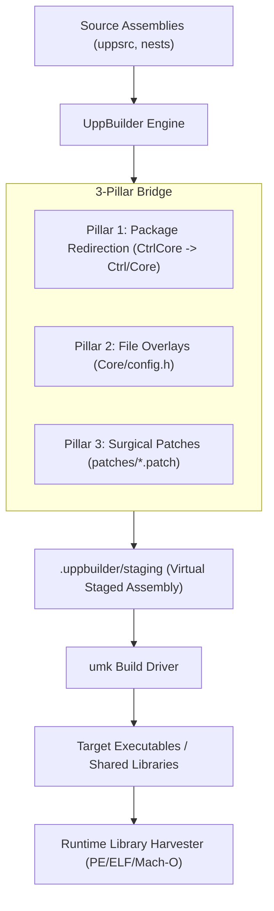

# UppBuilder

**UppBuilder** is an advanced meta-builder and `umk` driver for the [Ultimate++ (U++)](https://www.ultimatepp.org/) ecosystem, developed under [OuluBSD](https://github.com/OuluBSD).

It provides the **3-Pillar Bridge** to enable modular package development, non-destructive file overlays, and surgical upstream patching, alongside deep dependency analysis and header coupling inspection.

## Dependency Hierarchy

Part of the **OuluBSD U++ Modularization Architecture**:
```
UppBootstrap  <--  AdvancedBuilder (UppBuilder)  <--  BazaarCore  <--  IDE (DevEnv)
```
1. **`UppBootstrap`**: Zero-dependency toolchain bootstrap (`umk` compiler & build methods).
2. **`AdvancedBuilder` (`UppBuilder`)** (this repo): Standalone meta-builder with 3-pillar bridge, multi-assembly chaining, deterministic config keys.
3. **`BazaarCore`**: Foundation assembly (`patched-uppsrc`), single amalgamated `Core/Ext`, and Tier 3 packages (`Docking`, `Terminal`, `Manager`...).
4. **`IDE` (`DevEnv`)**: Modular developer environment application built on top of `BazaarCore` via `UppBuilder`.

---

## 🏛️ Architecture: The 3-Pillar Bridge



### 1. Package Redirection (Pillar 1)
Allows legacy monolithic package paths to transparently map to modular subpackages without modifying `.upp` files in pristine upstream checkouts:
```bash
./uppbuilder --redirect uppsrc/CtrlCore=uppsrc/Ctrl/Core --redirect uppsrc/CtrlLib=uppsrc/Ctrl/Lib <target>
```
Or via `redirects.json`:
```json
{
  "redirects": {
    "uppsrc/CtrlCore": "uppsrc/Ctrl/Core",
    "uppsrc/CtrlLib": "uppsrc/Ctrl/Lib"
  }
}
```

### 2. File Overlays (Pillar 2)
Provides non-destructive file substitutions into a virtual staged assembly before compilation:
```bash
./uppbuilder --overlay uppsrc/Core/config.h=overlay/Core/config.h <target>
```
Or via `overlays.json`:
```json
{
  "overlays": [
    {
      "target": "uppsrc/Core/config.h",
      "overlay": "overlay/Core/config.h",
      "platforms": ["all"]
    }
  ]
}
```

### 3. Surgical Patches (Pillar 3)
Applies unified diffs to the staged workspace with automatic conflict detection and rollback:
```bash
./uppbuilder --patch patches/0001-upphub-multi-root.patch <target>
```

---

## 🔍 Inspection & Dependency Tools

### Conditional `.upp` Evaluation per `mainconfig`
Accurately parses `uses(...)` directives evaluating boolean expressions against active flags (e.g., `GUI`, `DEBUG`, `POSIX`, `WIN32`):
```upp
uses(WIN32 | NOSO) plugin/z;
uses(!GUI) Core;
```

### Dependency Graph Generation
Generates complete topological dependency graphs in Mermaid, DOT, or JSON format:
```bash
# Mermaid diagram:
./uppbuilder --graph mermaid umk

# Graphviz DOT:
./uppbuilder --graph dot umk

# Plain text topological order:
./uppbuilder --dump-deps umk
```

### Header Coupling Scanner
Scans `#include` statements across package files, maps each header to its owning package, and highlights undeclared dependencies or tight coupling:
```bash
./uppbuilder --scan-headers Core
./uppbuilder --report-headers core-coupling.md
```

### Package Flag Auditor (Portage Phase 1)
Audits source code flag usages (`#ifdef flagFLAG`, `#if defined(flagFLAG)`) against package-level `acceptflags` declarations in `.upp` files. Identifies unaccepted code flags, unused acceptflags, and outputs unified diff patches:
```bash
# Audit a specific package:
./uppbuilder --audit-flags Core

# Audit all packages in assembly roots:
./uppbuilder --audit-flags --all

# Output suggested .upp patch:
./uppbuilder --audit-flags Core --audit-patch
```

### USE Flag Model & Policy Engine (Portage Phase 2)
Provides semantic USE flag algebra, policy files (`.uppbuilder/make.conf`, `package.use`, `package.mask`, `package.force`), flag scopes (`global`, `accepted`, `main_only`), conflict detection, and target compilation flag projection:
```bash
# Explain a semantic USE flag:
./uppbuilder explain-use sqlite
./uppbuilder explain-use virtualgui

# Inspect effective USE model and U++ flag projections for a package:
./uppbuilder use examples/AuditTestPkg --use "+sqlite -gtk st"

# Build applying USE flags:
./uppbuilder TargetPackage --use "+sqlite +virtualgui"
```

### Target Profiles & UppOverlay Catalog (Portage Phase 3)
Supports Gentoo Portage-style target profiles and the central [`UppOverlay`](https://github.com/OuluBSD/UppOverlay) package catalog with U++ Esc-syntax `.escbuild` specifications:
```bash
# List available target profiles (NativeClang, NativeGcc, MsvcX64, WasmBrowser):
./uppbuilder profile list

# Show detailed profile configuration and build method:
./uppbuilder profile show NativeClang

# List all virtual capabilities:
./uppbuilder virtual list

# Resolve virtual package to host platform provider (vcpkg, apt, brew, internal plugin):
./uppbuilder virtual resolve Virtual/Sqlite

# List and inspect packages in the UppOverlay catalog:
./uppbuilder overlay list
./uppbuilder overlay info DevCpp/BazaarCore
./uppbuilder overlay info DevUtil/UppBuilder

# Synchronize overlay catalog:
./uppbuilder overlay sync

# Build with a specific target profile:
./uppbuilder TargetPackage --profile NativeClang
```

---

## 🚀 Quick Start & Building

### 1. Standalone Bootstrap (Zero Dependencies)
Requires only standard `g++`, `clang++`, or `cl.exe` (C++17):

**Linux / macOS / POSIX:**
```bash
./bootstrap.sh
```

**Windows:**
```cmd
bootstrap.bat
```

### 2. Building via U++ `umk`
`UppBuilder` is also a native U++ package (`UppBuilder.upp`):
```bash
umk UppBuilder CLANG -br +DEBUG
```

### 3. Building via CMake
```bash
mkdir build && cd build
cmake ..
cmake --build .
```

---

## 📋 Command Line Reference

```text
Usage: uppbuilder [options] <target_package>

Build Options:
  -r, --release                 Build in release mode (default: debug)
  -c, --clean                   Clean build before compiling
  -m, --method <name>           Specify build method (e.g. CLANG, GCC, MSVS22x64)
  --mainconf <name|idx>         Select specific mainconfig configuration
  -H, --jobs <N>                Number of parallel compilation jobs
  -s, --shared                  Link with shared libraries
  -S, --build-shared            Build and link as shared libraries
  --static                      Force static library linking
  -o, --output <path>           Custom output binary path
  --copy-deps                   Copy non-system runtime libraries next to binary
  -v, --verbose                 Verbose diagnostics and commands

3-Pillar Bridge Options:
  --redirect <from>=<to>        Add package redirection mapping
  --redirects-file <file.json>  Load redirects from JSON file
  --overlay <target>=<source>   Add file overlay rule
  --overlays-file <file.json>   Load overlays from JSON file
  --patch <file>[@<dir>]        Add surgical patch to apply to staged workspace
  --patches-file <file.json>    Load patch list from JSON file
  --staging-dir <dir>           Custom staging directory (default: .uppbuilder/staging)

Inspection & Graph Analysis:
  --list-methods                List available build methods
  --list-mainconfigs <pkg>      List mainconfigs defined in package
  --dump-deps <pkg>             Print resolved active dependency tree
  --graph <format>              Output dependency graph (mermaid, dot, json)
  --scan-headers [pkg]          Scan header inclusions and report inter-package coupling
  --report-headers <file.md>    Save header coupling analysis to markdown file
  --audit-flags [pkg]           Audit package acceptflags against source code usage
  --audit-patch                 Output suggested acceptflags patch with audit results

Portage Package & USE Management:
  --use "<flags>"               Specify USE flags (e.g. "+sqlite -gtk st")
  use <pkg>                     Inspect resolved USE model and flag projections for package
  explain-use [flag]            Explain semantic meaning and mappings of a USE flag
  --policy-dir <dir>            Explicit path to .uppbuilder policy directory

Target Profiles & Portage Overlay:
  --profile <name>              Select target profile (e.g. NativeClang, NativeGcc, MsvcX64, WasmBrowser)
  profile list                  List all available target profiles
  profile show [name]           Show configuration details for a target profile
  virtual list                  List all virtual capability packages (Virtual/*)
  virtual resolve <name>        Resolve virtual package to host provider (vcpkg, apt, brew, plugin)
  overlay list                  List all packages indexed in UppOverlay
  overlay info <atom>           Show package metadata from .escbuild file
  overlay sync                  Pull latest updates from UppOverlay repository
  --overlay-dir <dir>           Explicit path to UppOverlay repository
```

---

## 📄 License
MIT License. Developed for the [OuluBSD Ecosystem](https://github.com/OuluBSD).
